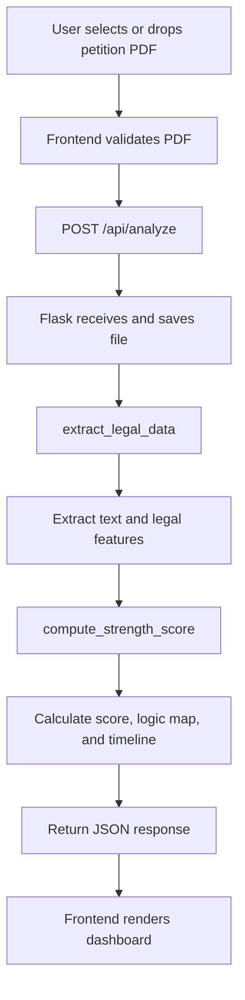

# NavaNyaya

NavaNyaya is a prototype legal-tech web application that analyzes a petition PDF and displays structured legal insights. It presents extracted legal provisions, evidence markers, judicial sentiment, a case strength score, causal explanations, and an estimated case timeline.

> This is a demonstration prototype. The current extraction and causal-analysis logic is simulated and is not legal advice.

## Project Structure

```text
NavaNyaya/
├── backend/
│   ├── app.py
│   ├── requirements.txt
│   └── ml_pipeline/
│       ├── extractor.py
│       └── causal_engine.py
├── frontend/
│   ├── index.html
│   ├── css/style.css
│   └── js/main.js
├── sample1.pdf
├── sample_petition.pdf
└── README.md
```

## Technologies Used

### Backend
- Python
- Flask and Flask-CORS
- pdfplumber for PDF text extraction
- transformers and PyTorch for planned legal NLP integration
- DoWhy and causalml for planned causal-inference integration
- pandas and NumPy for data processing

### Frontend
- HTML5
- CSS3
- Vanilla JavaScript
- Fetch API for backend communication

## Major Files and Functions

### Backend

#### `backend/app.py`
Main Flask server and API entry point.

- Creates the Flask application.
- Enables CORS for frontend requests.
- Defines `POST /api/analyze`.
- Validates and saves uploaded PDF files.
- Calls the extraction and causal-engine modules.
- Returns analysis results as JSON.

#### `backend/ml_pipeline/extractor.py`
PDF reading and legal-feature extraction module.

- Opens PDFs with `pdfplumber`.
- Extracts text from each page.
- Produces a short text summary.
- Returns provisions, evidence markers, and judicial sentiment.
- Currently uses simulated values instead of a trained legal NLP model.

#### `backend/ml_pipeline/causal_engine.py`
Case-strength scoring module.

- Reads evidence markers from extracted data.
- Assigns simulated causal impacts to evidence types.
- Calculates the overall strength score.
- Builds a causal logic map with explanations.
- Estimates a case duration in months.

#### `backend/requirements.txt`
Lists Python dependencies required by the backend.

### Frontend

#### `frontend/index.html`
Defines the dashboard structure.

- Provides the PDF upload area.
- Contains the score visualization.
- Displays extracted provisions, evidence, and sentiment.
- Contains the causal logic map and timeline sections.

#### `frontend/css/style.css`
Defines the visual presentation.

- Styles the layout, cards, upload zone, tags, and score circle.
- Provides responsive rules for smaller screens.
- Adds dashboard transitions and entrance animations.

#### `frontend/js/main.js`
Controls browser-side behavior.

- Handles click, drag-and-drop, and file-selection events.
- Validates PDF file extensions.
- Sends files to the Flask API using `fetch` and `FormData`.
- Renders API results into the dashboard.
- Provides demonstration data when the backend is unavailable.

## Workflow



## Setup and Run

### 1. Create and activate a virtual environment

From the project root in PowerShell:

```powershell
python -m venv environment4
.\environment4\Scripts\Activate.ps1
```

### 2. Install dependencies

```powershell
cd backend
pip install -r requirements.txt
```

### 3. Start the backend

```powershell
python app.py
```

The API runs at `http://127.0.0.1:5000`.

### 4. Open the frontend

Open `http://127.0.0.1:5000` after starting the backend. Flask serves both the frontend and API.

## Deploy to Render

The repository includes a Render Blueprint in `render.yaml`. To deploy:

1. Push the project to GitHub.
2. In Render, choose **New** → **Blueprint** and connect the NavaNyaya repository.
3. Review the `navanyaya` web service and select **Apply**.
4. When the first deploy finishes, open the service URL and check `/health`.

The single web service serves the static frontend and petition-analysis API from the same origin. Uploaded PDFs are removed after each analysis; Render's free service uses an ephemeral filesystem, so files are not retained between requests or restarts.

## API

### Analyze a petition

```http
POST /api/analyze
Content-Type: multipart/form-data
```

Form field:

- `file`: a PDF petition

Successful responses include:

```json
{
  "status": "success",
  "extracted_data": {
    "text_summary": "...",
    "provisions": [],
    "evidence_markers": [],
    "judicial_sentiment": "..."
  },
  "causal_inference": {
    "overall_strength_score": 0,
    "causal_logic_map": [],
    "estimated_duration_months": 0
  }
}
```

## Current Limitations

- Legal extraction is simulated rather than model-driven.
- Causal effects are heuristic and partly randomized.
- No database, authentication, or case-history storage is included.
- Uploaded files are stored locally.
- Results should not be treated as legal advice.

## Future Enhancements

- Integrate and load a real legal language model such as InLegalBERT.
- Train extraction models on legal petition data.
- Use real datasets with DoWhy or causalml.
- Add OCR for scanned PDFs.
- Add case-law retrieval, authentication, database storage, and report export.
